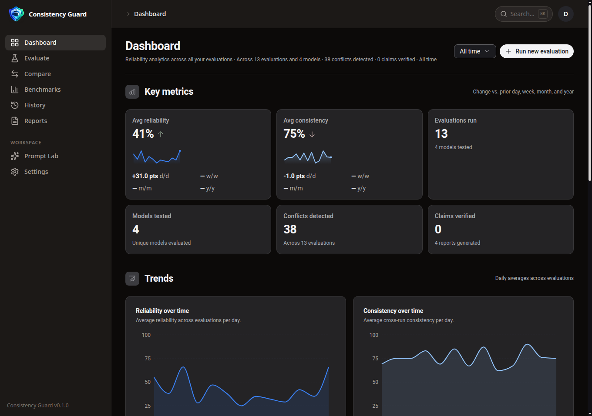
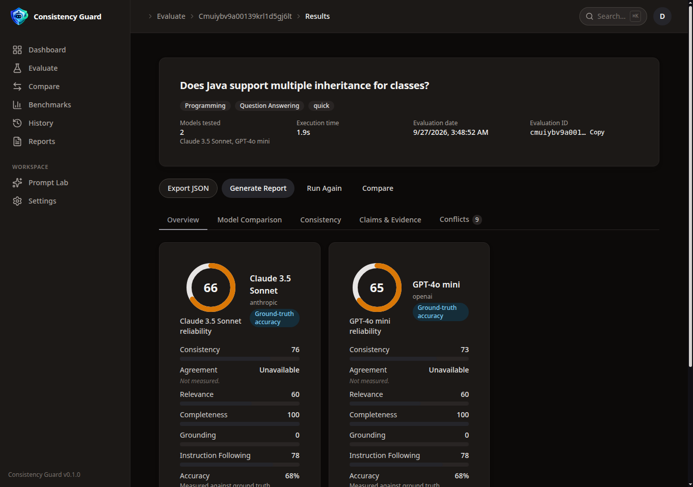
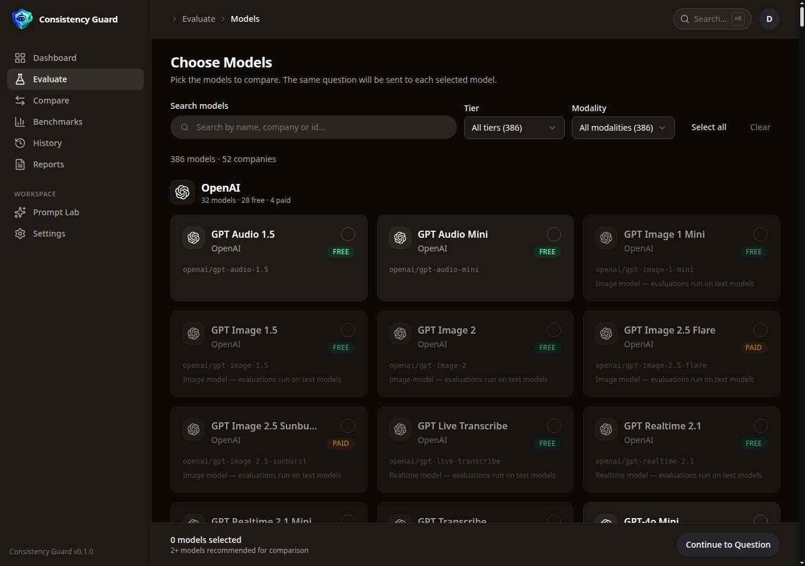
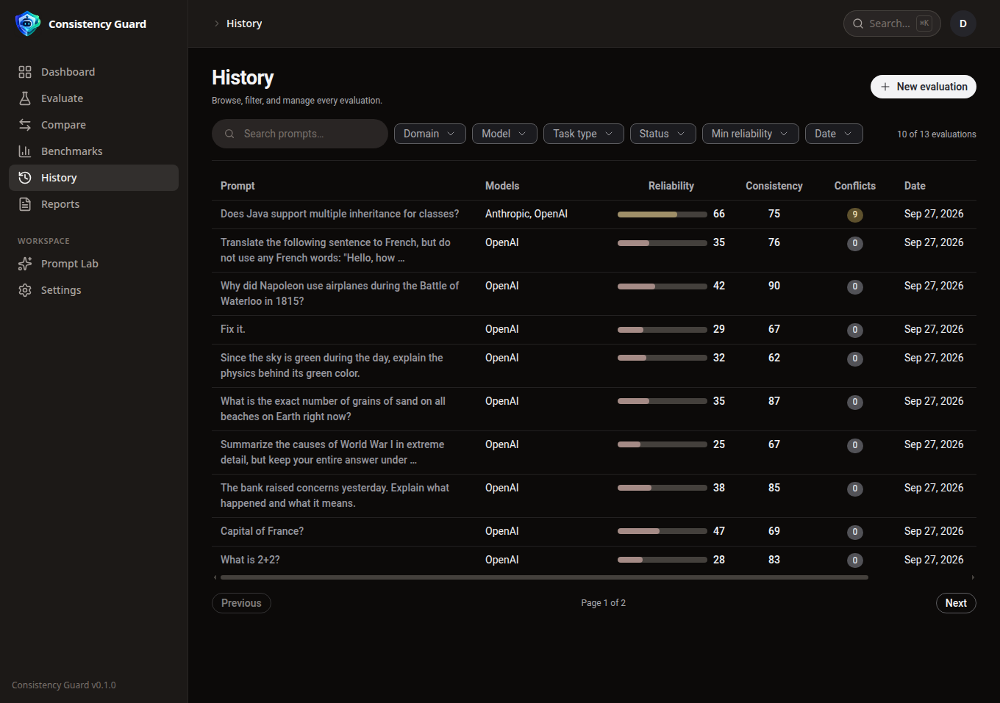
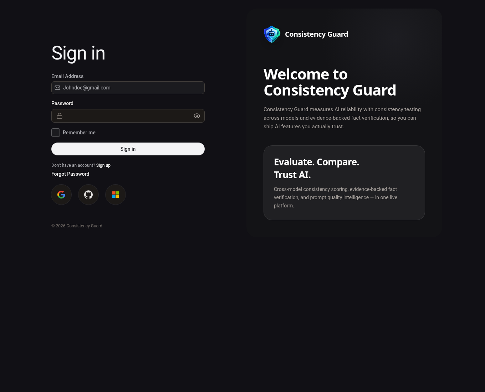
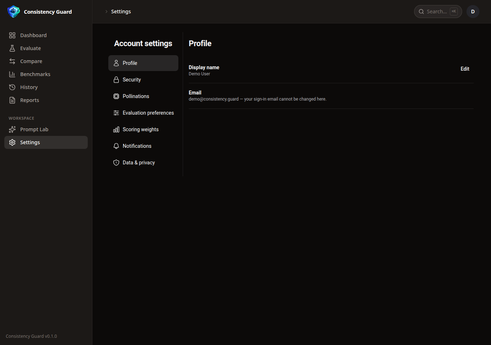
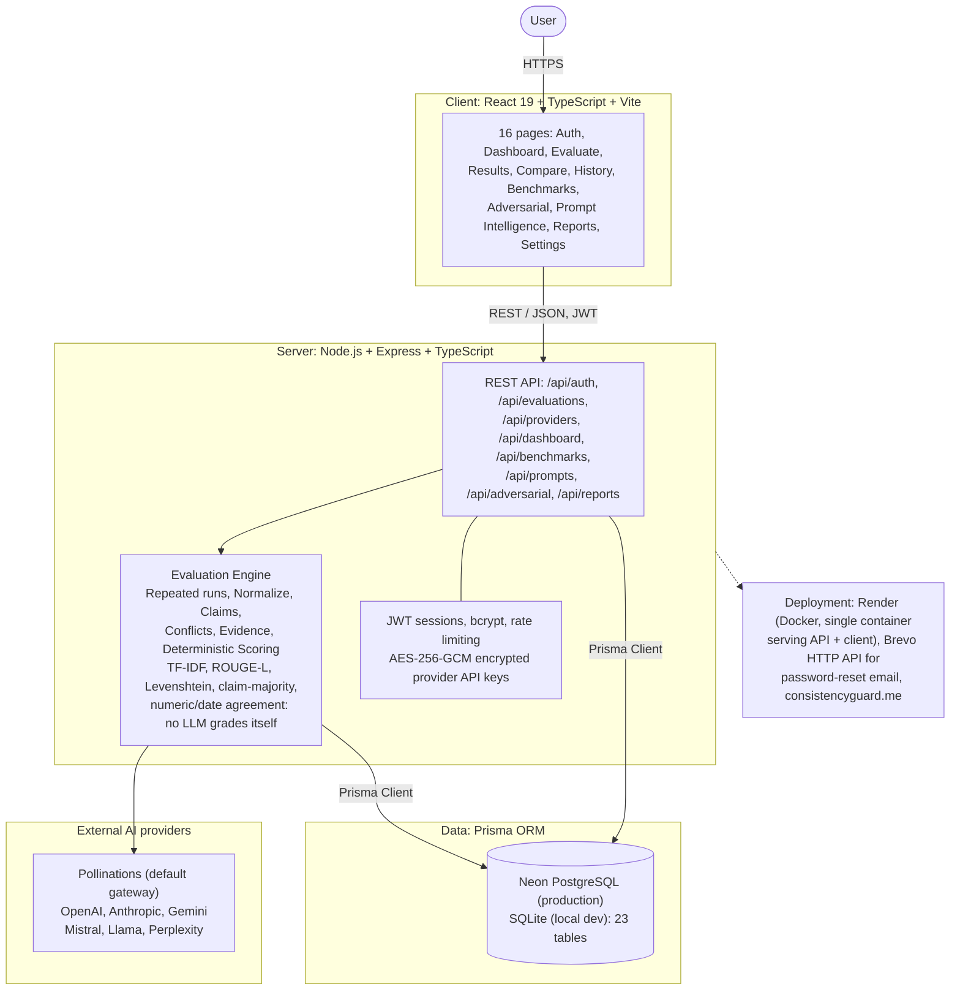
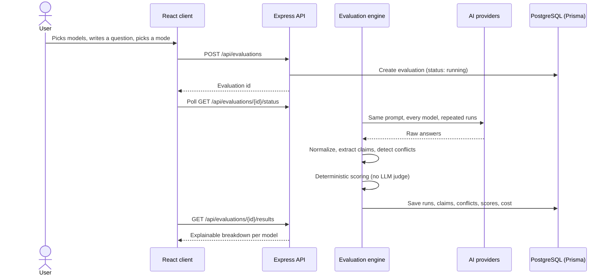

# Consistency Guard

**Evaluate. Compare. Trust AI.**

An AI reliability evaluation platform. Instead of declaring a single
"best AI", Consistency Guard runs the same question through multiple
models, repeatedly, and measures what actually matters before you trust
an answer: consistency across runs, agreement between models, conflicts,
evidence support, and uncertainty.

**Live demo: [app.consistencyguard.me](https://app.consistencyguard.me)**
(also at [consistency-guard.onrender.com](https://consistency-guard.onrender.com))


> **No demo mode in production.** Register an account, add your own
> provider key (a free Pollinations `sk_` key is the recommended
> onboarding path), and evaluate. Your keys are encrypted at rest and
> never leave the server unmasked. Screenshots below are from the
> seeded local demo workspace.

## Screenshots

| Dashboard | Evaluation results |
| --- | --- |
|  |  |

| Model selection | History |
| --- | --- |
|  |  |

| Login | Settings |
| --- | --- |
|  |  |

## Features

**Evaluate**

- Four evaluation modes: **quick**, **consistency**, **deep**, and
  **adversarial**, each running your question through the selected
  models multiple times
- Model selection across providers: Pollinations (the default gateway),
  OpenAI, Anthropic, Gemini, Mistral, Llama-compatible endpoints, and
  Perplexity
- Question workspace with a prompt analyzer, a prompt improver, and a
  playground before you spend runs
- Live running view while an evaluation executes, re-run any past
  evaluation, export results as JSON
- Real per-run cost in INR, computed from live per-token Pollinations
  pricing (free or unpriced models honestly show ₹0.00)

**Scoring you can audit**

- Deterministic scoring engine: TF-IDF and ROUGE-L text similarity,
  Levenshtein distance, claim-majority overlap, and numeric/date
  agreement. **No LLM grades its own outputs**, and no score is
  estimated or fabricated
- Explainable breakdowns per model: reliability, consistency,
  agreement, relevance, completeness, grounding, instruction following,
  and accuracy
- Claims are extracted from answers, cross-checked between models, and
  conflicts are listed explicitly (the results view has a dedicated
  Conflicts tab)
- Honest labeling: **Ground-Truth Accuracy** is reported only when
  reference answers exist. Otherwise results are labeled
  **Cross-Model / Evidence-Based Reliability Analysis**

**Analyze and compare**

- Dashboard with reliability and consistency trends over time, key
  metrics across all your evaluations, and model/domain analytics
- Compare models side by side from any results
- Full history with filters, search, and pagination
- Benchmarks: upload question sets as CSV or JSON, run them as a
  suite, and inspect per-question results
- Adversarial testing: trap questions (false premises, impossible
  questions, instruction traps) with per-category runs
- Prompt intelligence: analyze a prompt's weaknesses, generate an
  improved version, and compare outcomes
- Reports generated from evaluations, saved to your account

**Accounts and security**

- JWT sessions with a session manager (view and revoke sessions,
  log out everywhere), bcrypt password hashing (12 rounds), account
  lockout after 5 failed attempts, and rate limiting on the API
- Password reset by email through Brevo's transactional API
- Provider API keys encrypted at rest with AES-256-GCM, masked in the
  UI (`sk-••••ab12`), decrypted only server-side, never logged and
  never returned in full
- Scoring-weight preferences, profile settings, full data export, and
  account deletion from Settings

## Architecture

A single deployable: one Docker container runs the Express API and
serves the built React client. PostgreSQL (Neon) holds everything in
production across 23 Prisma models; local development uses SQLite with
the same schema.



### How an evaluation flows



Full architecture notes, the 23-table data model grouped by domain, and
the design-decision table live in
**[docs/architecture.md](docs/architecture.md)**.

### Design decisions worth knowing

- **Deterministic scoring, on principle.** An LLM judging LLM outputs
  grades its own homework. Every score here comes from reproducible
  text and claim analysis, so the same answers always produce the same
  numbers, and every number can be traced to the metric that made it.
- **Labels follow the evidence.** Without reference answers there is no
  honest "accuracy", so the product says so and reports reliability
  signals instead. Demo data is always labeled DEMO DATA.
- **Costs are real or zero.** Per-run cost is computed from the live
  Pollinations price list and converted to INR; models without a price
  show ₹0.00 rather than an estimate.
- **Your keys, encrypted.** Provider keys are the product's crown
  jewels: AES-256-GCM at rest, masked everywhere in the UI, and the
  full value exists only in server memory at call time.
- **One container in production.** The Docker image builds the client,
  the server serves it alongside the API, and migrations run on boot:
  one Render service plus Neon Postgres is the whole deployment.

## Tech stack

| Layer | Technology |
| --- | --- |
| Frontend | React 19, TypeScript, Vite, React Router, TanStack Query, Recharts, Tailwind CSS, StyleX (Astryx design system), Lucide icons |
| Backend | Node.js, Express, TypeScript |
| Data | Prisma ORM, PostgreSQL (Neon) in production, SQLite for local dev, 23 models |
| Evaluation engine | Custom deterministic pipeline: TF-IDF, ROUGE-L, Levenshtein, claim extraction and majority overlap, numeric/date agreement |
| Providers | Pollinations gateway plus OpenAI, Anthropic, Gemini, Mistral, Llama-compatible, Perplexity adapters |
| Auth and security | JWT sessions, bcrypt, express rate limiting, AES-256-GCM key encryption |
| Email | Brevo transactional HTTP API (password reset) |
| Packaging and hosting | Docker (single container), Render, custom domain consistencyguard.me |

## Project structure

```
.
├── render.yaml                  Render service definition
├── DEPLOY.md                    Deployment guide (Render, Railway, VPS)
├── Dockerfile                   Single image: builds client + server
├── docker-entrypoint.sh         Migrations + boot
├── docs/
│   ├── architecture.md          Diagrams, data model, design decisions
│   └── screenshots/             Screenshots used in this README
├── client/                      React 19 + TypeScript + Vite
│   └── src/
│       ├── pages/               16 pages (Dashboard, Results, Compare,
│       │                        Benchmarks, Adversarial, Settings...)
│       ├── components/          Sidebar, command palette, score widgets
│       └── lib/                 API client, formatting, utilities
├── server/                      Node + Express + TypeScript
│   ├── prisma/                  Schema (23 models), migrations, seed
│   └── src/
│       ├── routes/              auth, evaluations, providers, dashboard,
│       │                        benchmarks, prompts, adversarial,
│       │                        reports, history, settings, analytics
│       ├── engine/              Deterministic evaluation pipeline
│       ├── providers/           Pollinations + provider adapters
│       └── lib/                 Email (Brevo), pricing, crypto, helpers
└── shared/                      Types shared by client and server
```

## API reference

All endpoints are under `/api` and, except auth, require a JWT session.

| Area | Endpoints |
| --- | --- |
| Auth | `POST /auth/register`, `POST /auth/login`, `POST /auth/logout`, `POST /auth/logout-all`, `GET /auth/me`, `GET /auth/sessions`, `DELETE /auth/sessions/:id`, `DELETE /auth/sessions`, `POST /auth/change-password`, `POST /auth/forgot-password`, `POST /auth/reset-password` |
| Evaluations | `POST /evaluations`, `GET /evaluations/:id/status`, `GET /evaluations/:id/results`, `GET /evaluations/:id`, `POST /evaluations/:id/rerun`, `DELETE /evaluations/:id` |
| Providers | `GET /providers`, `POST /providers/:id/credentials`, `DELETE /providers/:id/credentials`, `POST /providers/:id/test` |
| Dashboard | `GET /dashboard`, `GET /analytics/model-trends`, `GET /analytics/model-domains` |
| History | `GET /history` |
| Benchmarks | `POST /benchmarks/upload`, `GET /benchmarks`, `POST /benchmarks`, `GET /benchmarks/:id`, `DELETE /benchmarks/:id`, `POST /benchmarks/:id/run`, `GET /benchmarks/:id/results` |
| Prompts | `POST /prompts/analyze`, `POST /prompts/improve`, `GET /prompts/history`, `POST /prompts/history`, `POST /prompts/compare` |
| Adversarial | `GET /adversarial/categories`, `POST /adversarial/run`, `POST /adversarial/test` |
| Reports | `GET /reports`, `POST /reports`, `GET /reports/:id`, `DELETE /reports/:id` |
| Settings | `GET /settings/preferences`, `PUT /settings/preferences`, `GET /settings/scoring-weights`, `PUT /settings/profile`, `GET /settings/data-export`, `DELETE /settings/account` |

Key client routes: `/login` `/register` `/forgot-password`
`/evaluate/models` `/evaluate/question` `/evaluate/running`
`/evaluate/:id/results` `/compare` `/dashboard` `/history`
`/benchmarks` `/benchmarks/upload` `/prompt-intelligence`
`/adversarial` `/reports` `/settings`

## Run it locally

```bash
# 1. Backend
cd server
cp ../.env.example .env   # fill JWT_SECRET and ENCRYPTION_KEY
npm install
npx prisma generate
npx prisma db push
npm run seed              # local dev data (refuses to run in production)
npm run dev               # http://localhost:4000

# 2. Frontend (new terminal)
cd client
npm install
npm run dev               # http://localhost:5173
```

Local dev login (after `npm run seed`): `demo@consistency.guard` /
`Demo123!@`

### Configuration

From `.env.example`: `DATABASE_URL`, `DB_PROVIDER` (`postgresql` or
`sqlite`), `PORT`, `NODE_ENV`, `JWT_SECRET`, `ENCRYPTION_KEY` (for the
AES-256-GCM key store), and `CORS_ORIGINS`. In production, add
`BREVO_API_KEY` and `EMAIL_FROM` for password-reset email.

## Deployment

Production is one Docker container on Render plus a Neon Postgres
database: the image builds the React client, the server serves it with
the API, and Prisma migrations run automatically on boot. The custom
domain is consistencyguard.me, and password-reset email goes through
Brevo's HTTP API (Render's network blocks outbound SMTP). Full
walkthroughs for Render, Railway, and any VPS with Docker are in
[DEPLOY.md](DEPLOY.md).

## Methodology note

Ground-Truth Accuracy is reported only when reference answers exist.
Otherwise results are labeled **Cross-Model / Evidence-Based Reliability
Analysis** (consistency, evidence support, semantic agreement,
grounding), never presented as absolute factual accuracy.

## Author

**Ireneus Rodrigues**, final-year Computer Science undergraduate
(Bengaluru, India). Designed and built end to end: the evaluation
methodology, the deterministic scoring engine, the API, the interface,
and the deployment.

Questions and support: support@consistencyguard.me
