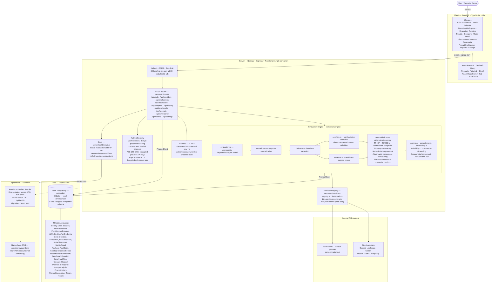
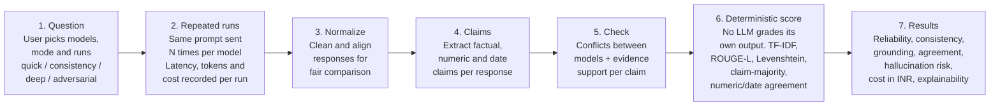

# Consistency Guard — Architecture

AI reliability evaluation platform. It runs the same question across multiple
AI models, repeatedly, and measures whether the answers agree with each other,
with themselves, and with evidence. It is not a "which AI is best" leaderboard.

Live: https://app.consistencyguard.me · Domain: consistencyguard.me

## System architecture



## Evaluation flow



## Design decisions that matter

| Decision | Why |
|---|---|
| Deterministic scoring only, no LLM-as-judge for the score | An LLM grading its own family of models is circular. Scores must be reproducible from the responses themselves. The old judge code is disabled and kept for reference. |
| Provider keys encrypted at rest (AES-256-GCM) | Users bring their own keys. Keys are never stored in plain text, never returned in full, and never logged. |
| Single Docker container serves API + client in production | Keeps the free-tier deployment simple and avoids CORS and split-deploy drift. Locally, Vite serves the client separately. |
| Postgres-compatible Prisma schema, SQLite locally | Local development needs zero setup, production on Neon Postgres needs no schema rewrite. |
| Reports never served as static files | A static URL would bypass auth. PDFs go out only through an authenticated, ownership-checked route. |
| Ground truth is labelled honestly | Accuracy is reported only when a reference answer exists. Otherwise results are labelled Cross-Model / Evidence-Based Reliability Analysis, never absolute factual accuracy. |

## Repository layout

```
client/   React 19 + TypeScript + Vite frontend (16 pages)
server/
  src/routes/      REST route handlers (11 route modules)
  src/engine/      Evaluation pipeline and deterministic scoring
  src/providers/   Provider adapters and registry (7 providers)
  src/middleware/  Auth and request guards
  src/lib/         Email (Brevo HTTP API) and shared helpers
  prisma/          Schema (23 models) and migrations
docs/     This architecture document
```
